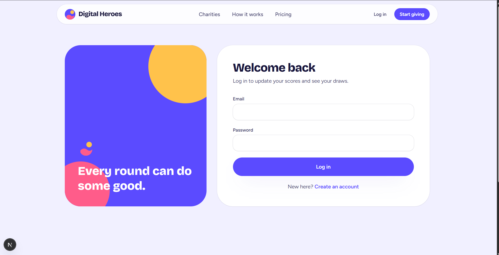
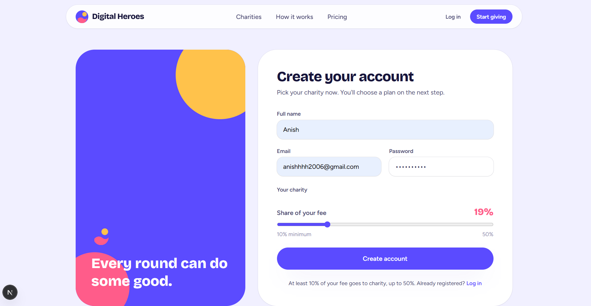
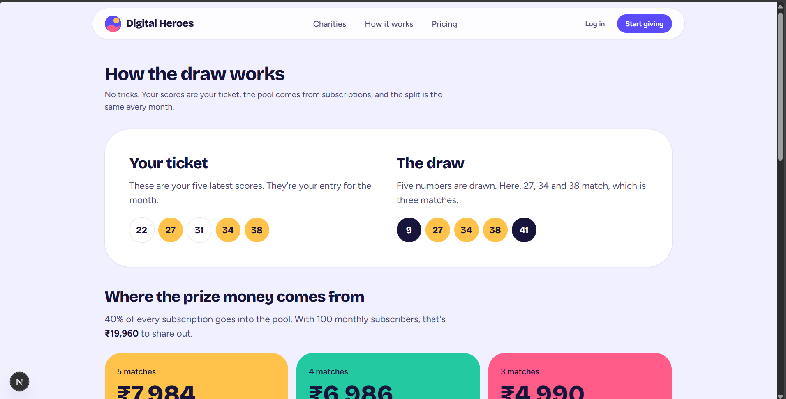
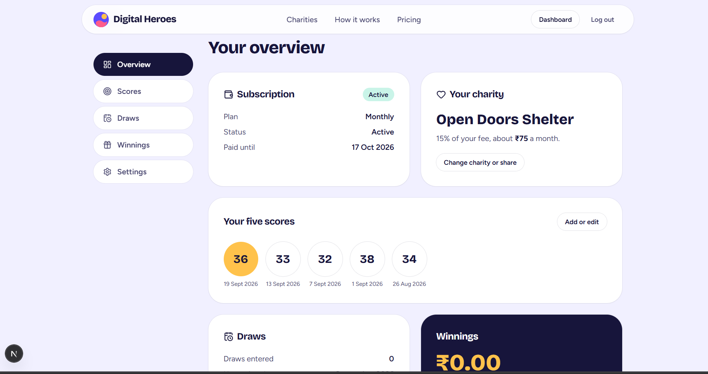
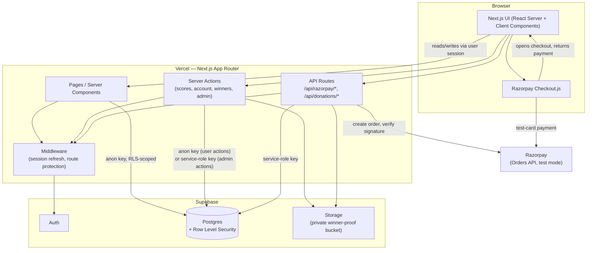
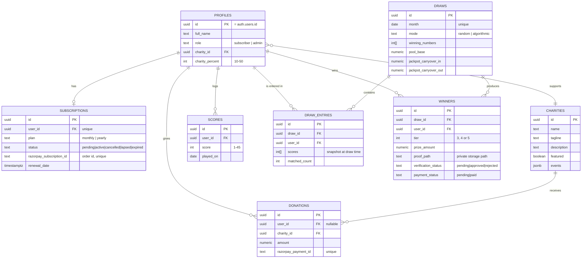
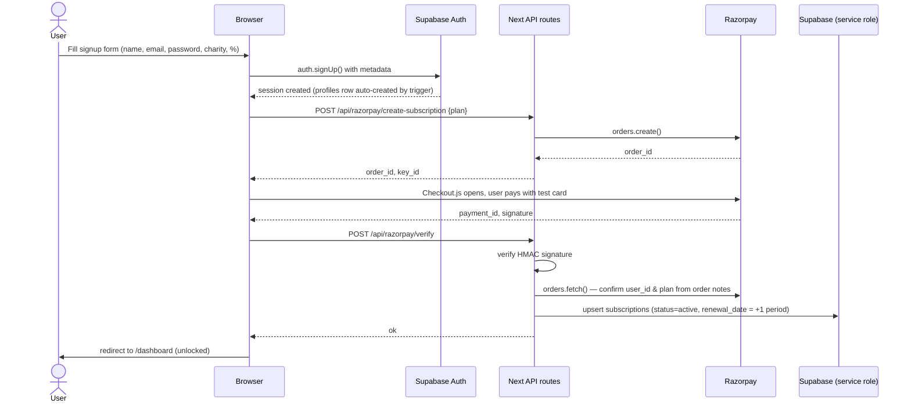
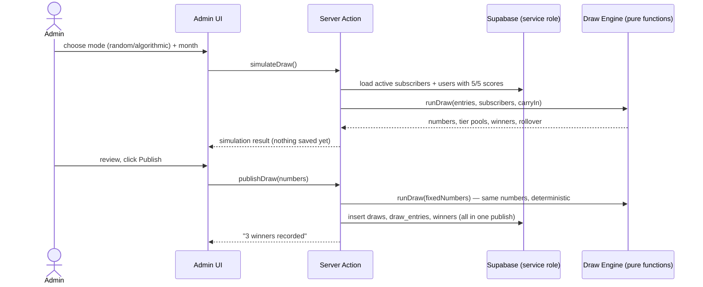
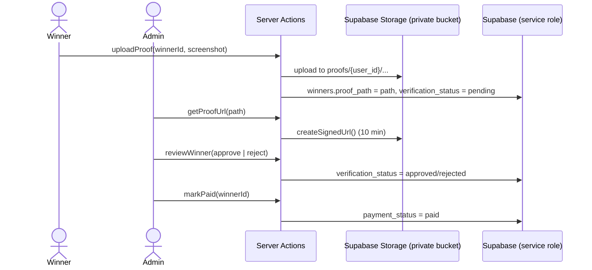

# Digital Heroes

A subscription platform combining golf performance tracking, a monthly prize draw and charity giving.
Built for the Digital Heroes PRD (Level 1) — full-stack trainee selection assignment.

**Live demo:** https://digital-heroes-chi-teal.vercel.app/

The project lives in the [`digital-heroes`](./digital-heroes) folder.
Setup steps, environment variables and test credentials are all below — this is the complete reference.

---

## Contents

- [Screens](#screens)
- [System architecture](#system-architecture)
- [Data model](#data-model)
- [Key flows](#key-flows)
- [Tech stack](#tech-stack)
- [Repository structure](#repository-structure)
- [Getting started](#getting-started)
- [Environment variables](#environment-variables)
- [Test credentials](#test-credentials)
- [Design decisions](#design-decisions--where-the-prd-was-open)
- [Testing](#testing)
- [PRD checklist](#prd-checklist)

---

## Screens

### Log in
Existing subscribers sign back in to manage scores and see draws.


### Create an account
New users pick their charity and a share of their fee (10%–50%) before choosing a plan.


### How the draw works
Explains the ticket, the draw, and where the prize pool comes from, with a worked example.


### Dashboard: scores
Subscribers add and manage their five most recent Stableford scores, newest first.


---

## System architecture



**Two Supabase clients, by design:**
- **User-session client** (anon key + cookies) — respects Row Level Security, used for anything a logged-in user does to their own data.
- **Service-role client** (`lib/supabase/admin.ts`) — bypasses RLS, used only in server-only code: the Razorpay webhook/verify routes, and every admin action (publishing draws, reviewing winners, managing charities and users).

---

## Data model



`scores(user_id, played_on)` and `winners(draw_id, user_id)` and `draw_entries(draw_id, user_id)` all carry a unique constraint — this is what enforces "one score per date" and "one result per draw per user" at the database level, not just in application code.

---

## Key flows

### 1. Sign up and subscribe (Razorpay Orders, test mode)



### 2. Admin runs the monthly draw



### 3. Winner verification and payout



---

## Tech stack

| Layer | Choice | Why |
|---|---|---|
| Framework | Next.js 14, App Router, TypeScript | Server Components + Server Actions + API routes in one deployable unit |
| Styling | Tailwind CSS, Framer Motion | Fast iteration, motion-enhanced UI per the PRD's design brief |
| Database / Auth / Storage | Supabase (Postgres, Row Level Security, Storage) | One managed backend covering all three needs, required by the PRD |
| Payments | Razorpay Orders API (test mode) | PCI-compliant, works without Subscriptions being enabled on the account |
| Hosting | Vercel | Required by the PRD; zero-config Next.js deploys |
| Testing | Vitest | Unit tests for the draw engine, prize math and score rules |

---

## Repository structure

```
digital-heroes/
├── supabase/
│   ├── schema.sql       tables, constraints, triggers, storage bucket
│   ├── policies.sql     Row Level Security policies
│   └── grants.sql       table-level GRANTs (fixes "permission denied" on some projects)
├── scripts/
│   └── seed.ts          6 charities, admin, 1 tester + 24 demo players with scores
├── src/
│   ├── middleware.ts     session refresh + route protection
│   ├── lib/
│   │   ├── config.ts      every business rule (score range, tiers, %, plans) in one file
│   │   ├── draw/          generate.ts, match.ts, prizes.ts, index.ts — pure, unit-tested
│   │   ├── scores.ts       rolling 5-score window logic
│   │   ├── subscription.ts access + payment-due logic
│   │   ├── charity.ts      fee-split math
│   │   ├── auth.ts         requireUser() / requireAdmin() guards
│   │   └── supabase/       browser.ts, server.ts (user session), admin.ts (service role)
│   ├── app/
│   │   ├── page.tsx, charities/, how-it-works/, (auth)/, subscribe/
│   │   ├── dashboard/       overview, scores, draws, winnings, settings
│   │   ├── admin/           reports, users, draws, charities, winners
│   │   ├── actions/         user-facing Server Actions
│   │   ├── admin/actions.ts admin Server Actions
│   │   └── api/razorpay/, api/donations/
│   ├── components/          ui/, home/, dashboard/, admin/, auth/
│   └── tests/                scores.test.ts, draw.test.ts, prizes.test.ts
└── docs/screenshots/
```

---

## Getting started

1. **Install:** `npm install`
2. **Supabase** (use a *new* project, per the PRD)
   - SQL Editor: run `supabase/schema.sql`, then `supabase/policies.sql`.
     If anything later fails with `permission denied for table ...`, also run `supabase/grants.sql`.
   - Authentication → Providers → Email: turn **off** "Confirm email" so demo signups work instantly.
   - Project Settings → API: copy the project URL, anon key and service-role key.
3. **Razorpay** (Test mode keys — Account & Settings → API keys)
   - Copy `.env.example` to `.env` and fill in the keys. Checkout uses Razorpay **Orders**, so there are no plan IDs or webhook setup required.
4. **Seed demo data:** `npm run seed`
5. **Run:** `npm run dev` → http://localhost:3000

### Deploying

Push to GitHub, import into Vercel, set every variable from `.env.example` (plus `NEXT_PUBLIC_SITE_URL` = your deployed URL) in Vercel → Settings → Environment Variables, then deploy.

---

## Environment variables

| Variable | Where it's used |
|---|---|
| `NEXT_PUBLIC_SUPABASE_URL` / `NEXT_PUBLIC_SUPABASE_ANON_KEY` | Browser + server, RLS-respecting client |
| `SUPABASE_SERVICE_ROLE_KEY` | Server-only: seed script, admin actions, payment verification |
| `RAZORPAY_KEY_ID` / `RAZORPAY_KEY_SECRET` | Creating orders, verifying payment signatures |
| `NEXT_PUBLIC_RAZORPAY_KEY_ID` | Browser, to open Razorpay Checkout.js |
| `NEXT_PUBLIC_SITE_URL` | Used in redirects after deploy |

---

## Test credentials

Created by `npm run seed`:

| Role | Email | Password |
|---|---|---|
| Admin | `admin@digitalheroes.test` | `Admin@12345` |
| Subscriber (active, 5 scores seeded) | `user@digitalheroes.test` | `User@12345` |
| 24 demo players (varied scores, for realistic draw results) | `player1@digitalheroes.test` … `player24@` | `Player@12345` |

Seeded accounts have an active plan but no real Razorpay order behind them. To test the actual payment flow end to end, sign up with a fresh email and pay with a Razorpay test card.

---

## Design decisions — where the PRD was open

| Question | This build's answer |
|---|---|
| What counts as a "match"? | A distinct score value that also appears in the 5 drawn numbers. Order doesn't matter. |
| Who is entered in a draw? | Subscribers with active access **and** all 5 scores logged at draw time. |
| Algorithmic draw weighting | Each number's odds are weighted by how often it appears across all entered scores (base weight of 1, so every number stays possible). |
| "Oldest" score, for the rolling window | Oldest by date played, not by when it was entered. |
| Prize pool funding | 40% of the *monthly-equivalent* fee — a yearly plan contributes 1/12th of its 40% share each month. |
| Do 4-match / 3-match tiers roll over? | No — only the unclaimed 5-match jackpot rolls over, per the PRD. |
| Payment model | One payment per billing period (not auto-renewing subscriptions), using Razorpay Orders — this keeps the build working on any Razorpay account regardless of whether Subscriptions is enabled. |
| Cancelling | Access continues until the already-paid period ends. |
| Charity totals in the admin report | Estimated live from active subscriptions × each user's %, plus recorded one-off donations. |

---

## Testing

```bash
npm test         # score window rules, draw generation, matching, prize split, rollover (16 tests)
npm run typecheck # TypeScript, no emit
```

Everything in `lib/draw/` and `lib/scores.ts` is written as pure functions with no I/O, specifically so the prize math and score rules can be tested without a database.

---

## PRD checklist

- [x] User signup & login (Supabase Auth)
- [x] Subscription flow — monthly and yearly (Razorpay, test mode)
- [x] Score entry — 5-score rolling logic, 1–45 range, one per date
- [x] Draw system — simulate before publish, random or algorithmic
- [x] Charity selection and contribution calculation (10%–50%)
- [x] Winner verification flow and payout tracking
- [x] User dashboard — subscription, scores, charity, participation, winnings
- [x] Admin panel — users, draws, charities, winners, reports
- [x] Data accuracy — unit-tested prize math and rollover logic
- [x] Responsive design, error handling, empty states
