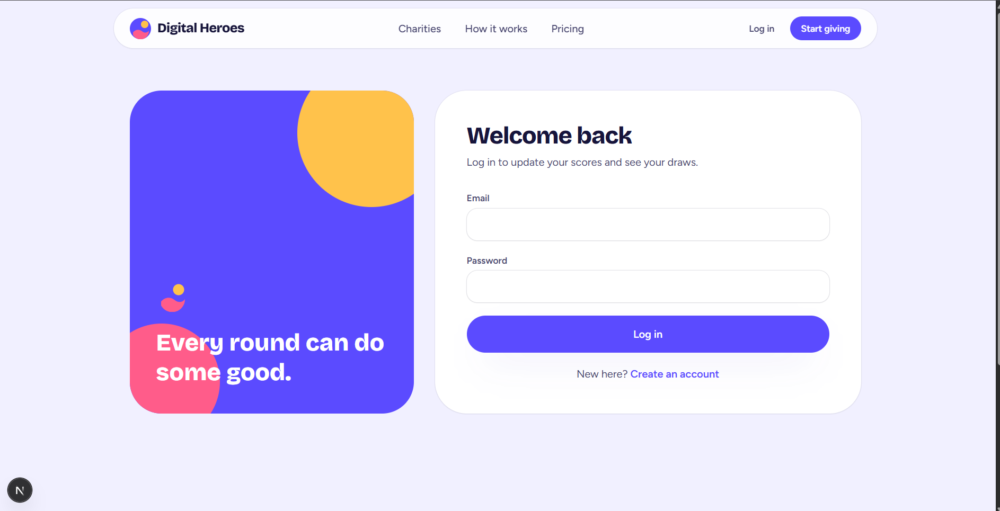
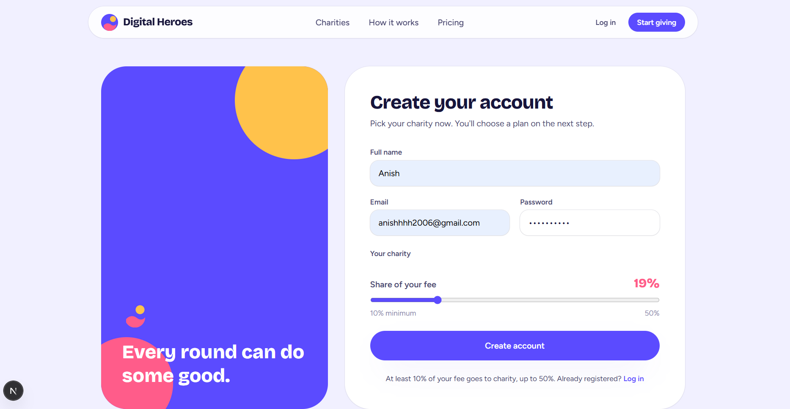
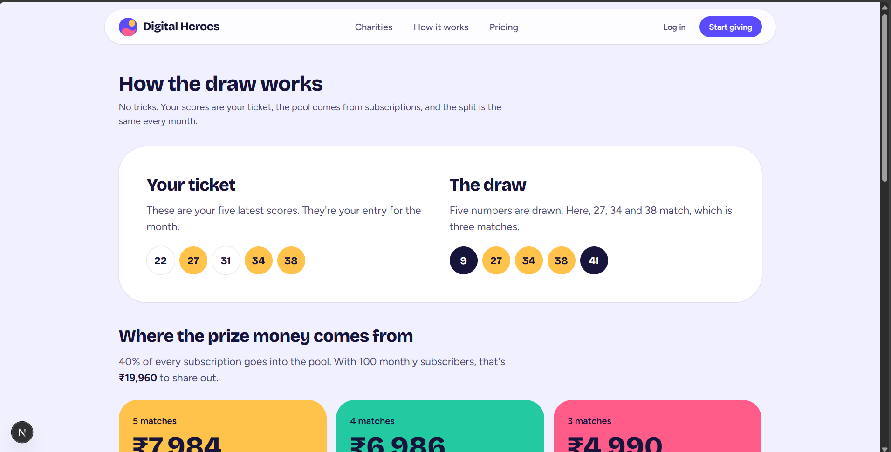
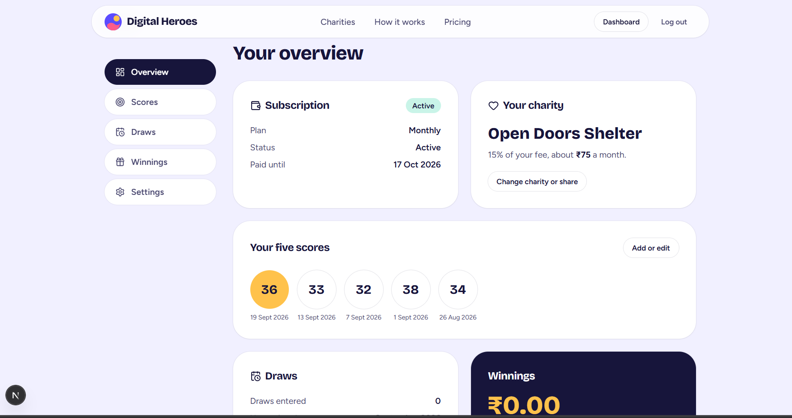

# Digital Heroes

A subscription platform that combines golf score tracking, a monthly prize draw and charity giving.
Built for the Digital Heroes PRD (Level 1).

**Live demo:** https://digital-heroes-chi-teal.vercel.app/
Test credentials are in the [Test credentials](#test-credentials-created-by-npm-run-seed) section below.

## Screens

### Log in
Existing subscribers sign back in to manage their scores and see their draws.

### Create an account
New users pick their charity and a share of their fee (10% to 50%) before choosing a plan.

### How the draw works
Explains the ticket, the draw, and where the prize pool comes from, with a worked example.

### Dashboard: scores
Subscribers add and manage their five most recent Stableford scores, newest first.

**Stack:** Next.js 14 (App Router) + TypeScript, Tailwind, Framer Motion, Supabase (Postgres, Auth, Storage), Razorpay, Vercel.

## Quick start

1. **Install:** `npm install`
2. **Supabase** (use a *new* project, as the PRD requires)
   - SQL Editor: run `supabase/schema.sql`, then `supabase/policies.sql`. If a later step fails with `permission denied for table ...`, also run `supabase/grants.sql` — some projects don't get the standard table grants set automatically.
   - Authentication > Providers > Email: turn **off** "Confirm email" so signups work instantly in the demo.
   - Project Settings > API: copy the URL, anon key and service-role key.
3. **Razorpay** (Test mode keys)
   - Dashboard > Account & Settings > API keys: generate a key pair.
   - Copy `.env.example` to `.env` and fill in the keys. Both `npm run dev` and `npm run seed` read from this file. Checkout uses Razorpay Orders, so there are no plan IDs to create.
4. **Seed demo data:** `npm run seed`
5. **Run:** `npm run dev` and open http://localhost:3000

## Test credentials (created by `npm run seed`)

| Role | Email | Password |
|---|---|---|
| Admin | admin@digitalheroes.test | Admin@12345 |
| Subscriber (active, 5 scores) | user@digitalheroes.test | User@12345 |
| 24 demo players | player1@digitalheroes.test ... player24@ | Player@12345 |

Seeded subscribers have an active plan but no Razorpay order recorded. To test real checkout, sign up with a new email and pay with Razorpay's test card.

## Deploying to Vercel

1. Push to a new GitHub repo, import it into a **new** Vercel account.
2. Add every variable from `.env.example` in Vercel > Settings > Environment Variables. Set `NEXT_PUBLIC_SITE_URL` to your Vercel URL.
3. The webhook route (`/api/razorpay/webhook`) is optional and not used by order checkout, so you can skip webhook setup.

## How it works

| Area | Behaviour |
|---|---|
| Subscription | Monthly and yearly plans paid through Razorpay Orders (one payment per period, test mode). Payment is verified server-side, then the plan is active until the period ends. Renewal opens in the last 7 days. Access is re-checked on every score write and dashboard load. |
| Scores | Range 1 to 45, one per date, latest five kept. A sixth score removes the oldest. |
| Draw | Admin picks random or algorithmic, runs a **simulation**, then publishes the exact simulated numbers. Publishing saves the draw, every entry and every winner. |
| Prize pool | 40% of each subscription (monthly equivalent) funds the pool. Split 40 / 35 / 25 across 5, 4 and 3 matches. Equal split inside a tier. Unclaimed 5-match jackpot rolls over. |
| Charity | Chosen at signup. Minimum 10%, maximum 50%. One-off donations are separate. |
| Winners | Winner uploads a screenshot. Admin approves or rejects, then marks the prize paid. |

## Decisions where the PRD was open

These are the interpretations this build uses:

- **Matching:** a match is a distinct score value that appears in the five drawn numbers. Order is ignored.
- **Who is entered:** subscribers with access *and* all five scores logged.
- **Algorithmic draw:** each number's odds are weighted by how often it appears in entered scores (with a base weight of 1 so every number is possible).
- **Rolling window:** "oldest" means oldest by date played. A round older than your latest five is rejected with a clear message.
- **Pool funding:** 40% of the monthly-equivalent fee. Yearly plans contribute a twelfth each month.
- **Unclaimed 4 and 3 tiers:** don't roll over (only the jackpot does, per the PRD).
- **Payments:** each payment buys one period (a month or a year) instead of auto-renewing, so the build works on any Razorpay account.
- **Cancelling:** access continues until the paid period ends.
- **Charity totals in reports:** estimated from active subscriptions and each user's percentage, plus recorded donations.

## Project map